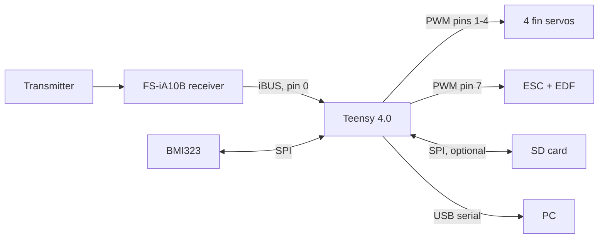
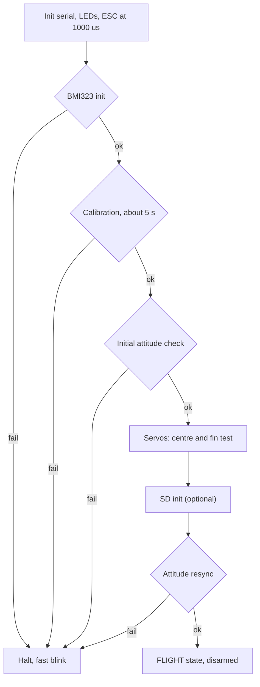
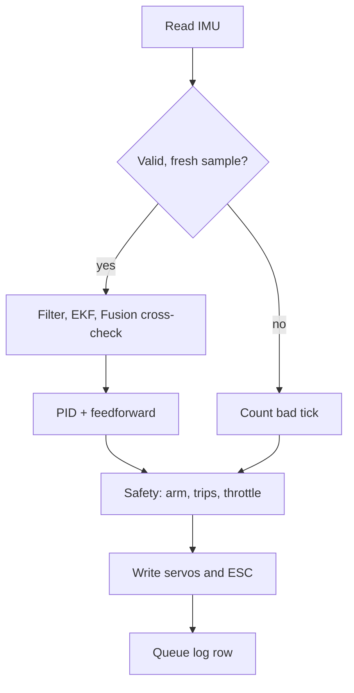

# System Architecture

Part of the [README](../README.md). Source: [`tvc_rocket4.ino`](../src/tvc_rocket4/tvc_rocket4.ino).

## Overview

One microcontroller runs a fixed-rate loop. Every 5 ms (200 Hz) it reads the IMU, estimates tilt, computes fin commands, sets the motor throttle from the pilot's stick (after safety checks) and queues a log row. When there is spare time and the motor is idle, it writes the log to the SD card.

| Component | Role |
|---|---|
| Teensy 4.0 firmware | Makes every decision |
| BMI323 | Measures angular rate and acceleration |
| Receiver (iBUS) | Delivers pilot commands; Ch5 is the arm/kill switch |
| 4 servos | Move the fins |
| ESC + EDF | Produce thrust |
| SD card (optional) | Stores logs |
| LEDs (PCB only, optional) | Show status |

| Link | Settings |
|---|---|
| IMU | SPI mode 0, 8 MHz, CS = A4 |
| SD | SPI 4 MHz, CS = pin 10 |
| Receiver | `Serial1`, 115200 baud, iBUS |
| ESC / servos | `Servo` library, 1000–2000 µs pulses |
| USB | 115200 baud, status text and live CSV rows at 20 Hz |

## Startup

Startup failures halt the system with the motor at 1000 µs. On the PCB, the red parts LED shows whether the BMI323 or the SD card failed. A missing SD card never halts startup.

## Every tick

## States

| State | Meaning |
|---|---|
| Boot / servo startup | Calibrating and testing fins; motor 1000 µs |
| FLIGHT, disarmed | Fins react to tilt (useful for safe bench testing); motor 1000 µs |
| FLIGHT, armed | Motor follows the throttle stick |
| FAULT | A latched fault cut the motor; fins neutral; cleared by cycling Ch5 |
| STARTUP_FAILED | Halted until reset |

Tilt and spin trips also cut the motor until Ch5 is cycled. Details: [rc-input-motor-and-safety](rc-input-motor-and-safety.md).

## Failure handling

| Failure | Response |
|---|---|
| Bad or stale IMU samples | 2 in a row: fins neutral. 8 in a row: latched fault, motor off |
| EKF state invalid | Latched fault |
| EKF and Fusion disagree > 20° for 500 ms while armed | Latched fault |
| NaN in control output | Latched fault, outputs zeroed |
| No iBUS frame for 150 ms | Motor off |
| Tilt > 45° | Fins neutral |
| SD error or no SD | Logging stops or is skipped; flight control unaffected |

## Documents

[hardware-and-wiring](hardware-and-wiring.md) · [imu-driver-and-calibration](imu-driver-and-calibration.md) · [state-estimation](state-estimation.md) · [flight-control-and-mixing](flight-control-and-mixing.md) · [rc-input-motor-and-safety](rc-input-motor-and-safety.md) · [logging-and-diagnostics](logging-and-diagnostics.md) · [setup-testing-and-tuning](setup-testing-and-tuning.md)
